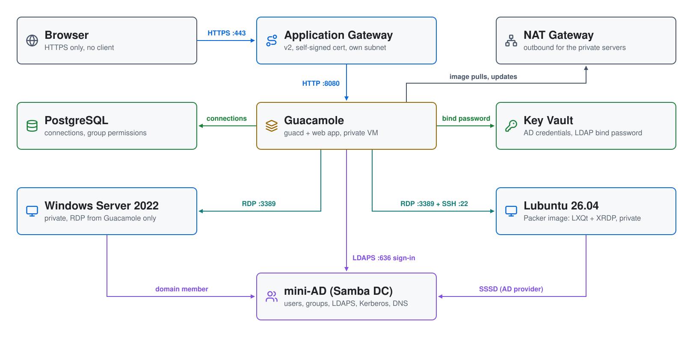

# Apache Guacamole + Active Directory on Azure

A browser-only gateway into a **private** Windows and Linux environment.
**Apache Guacamole** sits behind an Azure Application Gateway. Users sign in
with their Active Directory account, then open an RDP session to a Windows
host, or an LXQt desktop (over XRDP) or an SSH session on a Lubuntu host, all
in the browser and all as themselves. No server has a public IP, and there's
no VPN, bastion or SSH key to hand out.

| Piece | Where | Role |
|---|---|---|
| **Application Gateway** (Standard_v2) | its own subnet | HTTPS with a self-signed certificate from Key Vault; HTTP redirects to HTTPS. The only internet-facing piece. |
| **Guacamole** | VM subnet, private | guacd + the Guacamole web app + PostgreSQL, in Docker, on Ubuntu 24.04 |
| **Windows Server 2022** | VM subnet, private | joined to AD; RDP from Guacamole only |
| **Lubuntu 26.04** | VM subnet, private | Packer-built image (LXQt + XRDP + Firefox); joined to AD with SSSD at boot; RDP and SSH from Guacamole only |
| **mini-AD** (Samba DC) | mini-AD subnet | users, groups, DNS, Kerberos, LDAPS |
| **Key Vault** | network resource group | AD credentials, the gateway's certificate |
| **NAT gateway** | VM and mini-AD subnets | outbound internet for the private servers |

## Architecture

<picture>
  <source media="(prefers-color-scheme: dark)" srcset="architecture-dark.svg">
  
</picture>

Regenerate with `python3 make_diagram.py`.

- **`01-directory/`**: the VNet (a VM subnet, the DC's subnet, and an empty
  subnet for the Application Gateway), the network security groups, the NAT
  gateway, Key Vault, and the
  [`module-azure-mini-ad`](https://github.com/mamonaco1973/module-azure-mini-ad)
  Samba DC with users and POSIX attributes from `users.json`. The module
  points the VNet's DNS at the DC.
- **`02-packer/`**: builds the Lubuntu managed image from Canonical's Ubuntu
  26.04 image: the LXQt core (no office, mail or media apps), Firefox as a
  snap, XRDP with an LXQt session, and the SSSD and realmd packages. The
  domain join is left to boot time, because a computer account and keytab
  can't be baked into a shared image.
- **`03-servers/`**: the Application Gateway and its certificate, the
  Guacamole server, the Lubuntu and Windows hosts, and their NIC memberships
  in the security groups.

## How sign-in works

1. The user browses to the Application Gateway and signs in to Guacamole as
   an AD user (`jsmith`). Guacamole checks the password against AD over
   **LDAPS**. Only members of **`mcloud-users`** are allowed in.
2. Guacamole's PostgreSQL database holds three connections: **Windows
   (RDP)**, **Lubuntu (RDP)** and **Lubuntu (SSH)**. They're granted to a
   database group named `mcloud-users`, and Guacamole applies that group to
   anyone who belongs to the AD group of the same name.
3. All three use Guacamole's `${GUAC_USERNAME}` / `${GUAC_PASSWORD}`
   tokens, so each session logs in to the target **as the signed-in user,
   with their AD password**. One sign-in reaches both machines.
   - Windows RDP uses NLA with the `MCLOUD` domain.
   - XRDP doesn't support NLA, so the Lubuntu RDP connection uses TLS
     security and no domain; PAM and SSSD check the bare username against AD.
4. Members of **`linux-admins`** (jsmith and rpatel) also get Guacamole's
   administer right, so they can add connections in the UI. The built-in
   `guacadmin`/`guacadmin` account is disabled.

Who is an administrator where (from `01-directory/scripts/users.json.template`):

| User | `linux-admins`: sudo on Lubuntu + Guacamole admin | `Domain Admins`: admin on Windows and in AD |
|---|---|---|
| jsmith | yes | yes |
| rpatel | yes | yes |
| edavis | no | no |
| akumar | no | no |

All four are in `mcloud-users`, so all four can sign in to Guacamole and
use all three connections.

For LDAPS, Guacamole must trust the DC's certificate. The Samba DC creates
its own CA and serves it at `http://ad1.<domain>/ca.pem`. The Guacamole
server fetches it at boot and puts it in a Java trust store for the web app.

## Network security groups

```
internet ─443/80─▶ App Gateway ─8080─▶ Guacamole ─3389─────▶ Windows
                                                 └─22, 3389─▶ Lubuntu
```

The VM subnet's NSG is written against three application security groups
(`guacamole-asg`, `windows-asg`, `lubuntu-asg`) that the servers' NICs join.
It ends with a rule that denies all other traffic from inside the VNet,
because Azure's default rules would otherwise allow it. The App Gateway
subnet has its own NSG, which also admits the `GatewayManager` ports
(65200-65535) and the `AzureLoadBalancer` probe that the v2 SKU requires.

`allowed_cidrs` (in `01-directory/variables.tf`) controls who can reach the
App Gateway. It defaults to `0.0.0.0/0`; every login still needs an AD
account in `mcloud-users`. To limit it to your own address:

```bash
export TF_VAR_allowed_cidrs='["203.0.113.7/32"]'
./apply.sh
```

Admin access to the private servers is **`az vm run-command`**, which runs
a script through the VM agent and needs no network path. For example:

```bash
az vm run-command invoke -g guacamole-project-rg -n guacamole \
  --command-id RunShellScript --scripts 'tail -50 /root/userdata.log'
```

## Prerequisites

* [An Azure subscription](https://azure.microsoft.com/) and a service
  principal with Owner (or Contributor + User Access Administrator) on it,
  exported as `ARM_CLIENT_ID`, `ARM_CLIENT_SECRET`, `ARM_SUBSCRIPTION_ID`
  and `ARM_TENANT_ID`
* [Install Azure CLI](https://learn.microsoft.com/cli/azure/install-azure-cli)
* [Install Terraform](https://developer.hashicorp.com/terraform/install)
* [Install Packer](https://developer.hashicorp.com/packer/install)
* [Install jq](https://jqlang.github.io/jq/download/) and `curl`

## Deploy

```bash
./apply.sh       # 1: VNet + Key Vault + mini-AD  2: Lubuntu image (Packer)  3: App Gateway, Guacamole, servers
./validate.sh    # waits for Guacamole, signs in as jsmith, prints the URL
```

The Packer build takes about 15 minutes, and each run of `apply.sh` builds a
fresh image. Phase 3 always uses the newest one. The Application Gateway
alone takes 5 to 10 minutes to create.

`validate.sh` signs in to Guacamole's API as `jsmith` and checks that all
three connections are granted. That exercises LDAPS, the group gate and the
database permissions. It also checks the HTTP redirect and that no VM has a
public IP. It ends with:

```
Guacamole + Active Directory
============================
URL      : https://guacamole-abc123.centralus.cloudapp.azure.com/
           Self-signed certificate: the browser warns once;
           choose Advanced > Proceed.
Sign in  : jsmith / orange-481920
           (any mcloud-users member; passwords in Key Vault ad-key-vault-xxxxxxxx
           as <user>-credentials)
Connect  : Windows (RDP), Lubuntu (RDP desktop) and Lubuntu (SSH),
           as the signed-in user.
```

## Try it

1. Open the URL, accept the certificate warning, and sign in as `jsmith`.
2. Click **Lubuntu (RDP)**: an LXQt desktop opens as `jsmith`, whose home
   directory is created on first login. Firefox is on the desktop, in the
   panel and in the menu, and it is the default browser. **Lubuntu (SSH)**
   gives a terminal on the same host. Try `id`, `getent group linux-admins`,
   and `sudo -l` (linux-admins have passwordless sudo).
3. Go back (Ctrl+Alt+Shift opens the Guacamole menu) and click **Windows
   (RDP)**: a desktop opens as `MCLOUD\jsmith`. **Active Directory Users and
   Computers** is installed, and jsmith is a local administrator through
   `Domain Admins`.
4. Sign out and sign in as `edavis`: the same three connections, as edavis.
   edavis isn't in `linux-admins` or `Domain Admins`, so there's no
   Guacamole admin menu, no sudo on Lubuntu, and only a standard user's
   rights on Windows. (rpatel, like jsmith, is an admin everywhere.)

User passwords are in Key Vault as `<user>-credentials`:

```bash
vault=$(az keyvault list -g guacamole-network-rg --query "[0].name" -o tsv)
az keyvault secret show --vault-name "$vault" --name edavis-credentials \
  --query value -o tsv | jq -r .password
```

## Troubleshooting

| Symptom | Fix |
|---|---|
| `validate.sh`: backend not healthy | Guacamole's setup is still running or failed. `az vm run-command invoke -g guacamole-project-rg -n guacamole --command-id RunShellScript --scripts 'tail -50 /root/userdata.log'`. |
| Sign-in fails for everyone | LDAPS: on the Guacamole server, `cd /opt/guacamole && docker compose logs guacamole`. Check `/opt/guacamole/tls/ca.pem` was fetched from the DC. The DC must be built from a mini-AD module version that serves `/ca.pem`. |
| One user can't sign in | They must be in AD group `mcloud-users`. |
| Windows (RDP) disconnects at once | Check the domain join: the `customScript` extension runs `ad-join.ps1`, which joins the domain and reboots, and its log is `C:\WindowsAzure\Logs\ad-join.log`. The join finishes during `apply.sh`, so a host that still rejects domain logins afterwards has a failed join, not a slow one. |
| Lubuntu (SSH or RDP) rejects the password | The host hasn't finished its domain join; check `/root/userdata.log` with `az vm run-command`. |
| A setup log shows `waiting for Key Vault access` for a minute or two | Expected: the VM's role assignment is created after the VM and takes a while to propagate. The scripts retry for up to 10 minutes. |
| SSH prompt shows `start=...;type=shell;cwd=...` text | systemd 258+'s OSC 3008 prompt escapes, which Guacamole's terminal prints instead of hiding. A tmpfiles.d rule re-creates `/etc/profile.d/80-systemd-osc-context.sh` at every boot, so the image masks the rule (`02-packer/scripts/03-xrdp.sh`). On an older image: `sudo ln -sf /dev/null /etc/tmpfiles.d/20-systemd-osc-context.conf && sudo rm -f /etc/profile.d/80-systemd-osc-context.sh`. |
| Lubuntu (RDP) connects, then closes | Check `/var/log/xrdp-sesman.log` on the host. The session runs `/etc/xrdp/startwm.sh`, which starts LXQt. |
| Firefox doesn't open in the desktop ("Authorization required") | Snaps need `XAUTHORITY` exported; `/etc/xrdp/startwm.sh` does that. Sessions started before an image change keep the old environment: sign out and back in. |
| LXQt panel has no application menu, or its menu button is blank | Ubuntu 26.04 (LXQt 2.3) specifics, handled in `02-packer/scripts/02-desktop.sh`: `lxqt-core` no longer pulls in `lxqt-menu-data` (no menu without it), the panel's menu plugin is `fancymenu` (the old `mainmenu` doesn't load), and the Debian branding theme draws `fancymenu`'s button blank, so the image switches the LXQt theme to `dark`. |
| Links don't open, or `xdg-open` says `command not found` / "no method available" | `xdg-utils` isn't part of `lxqt-core`, and under `XDG_CURRENT_DESKTOP=LXQt` it hands off to `qtxdg-mat` from `qtxdg-tools`. The image installs both, and the build fails if LXQt doesn't resolve Firefox as the default browser. |
| Remote session drops after a while | Two App Gateway timers apply to Guacamole's WebSocket: the backend `request_timeout` (an idle timer, set to 3600 s) and the public IP's TCP idle timeout (set to the 30-minute maximum). Guacamole's keep-alives reset both. |
| Application Gateway fails to deploy with a Key Vault access error | Its identity's role assignment hadn't propagated. `03-servers/appgateway.tf` waits 90 seconds; re-run `./apply.sh` if Azure was slower. |
| Application Gateway fails to deploy with `InternalServerError` ("An error occurred.") | Reported after several minutes with no detail. It happened whenever the gateway was created while the Windows domain-join extension was running, so `03-servers/appgateway.tf` now waits for the extension. It leaves a `Failed` gateway that Terraform doesn't track, so `./apply.sh` deletes it and retries phase 3 (up to 3 attempts). To recover by hand: `az network application-gateway delete -g guacamole-project-rg -n guacamole-app-gateway`, then re-run `./apply.sh`. |
| Browser certificate warning | Expected: the certificate is self-signed. Import a CA-issued certificate into Key Vault and point a DNS name at the gateway to remove it. |

## Teardown

```bash
./destroy.sh     # destroys phase 3, deletes the Lubuntu images, destroys phase 1 (Key Vault purged)
```

`destroy.sh` skips any phase that has nothing left, so it is safe to re-run.

## Notes

- **Lab only.** The certificate is self-signed, the App Gateway is open by
  default, and Guacamole binds to LDAP with the domain admin account (its
  password is in the server's `/opt/guacamole/.env`, readable only by root).
  Use a dedicated read-only bind account and a real certificate for anything
  more.
- **Cost.** An Application Gateway v2 has a fixed hourly charge while it
  exists, even with no traffic (an AWS ALB costs almost nothing idle). Run
  `./destroy.sh` when you are done.
- Users, groups and POSIX IDs are defined in
  `01-directory/scripts/users.json.template`.
- `04-utils/` has PowerShell helpers that ask the DC for the next free
  UID/GID, for creating POSIX users from the Windows host.
